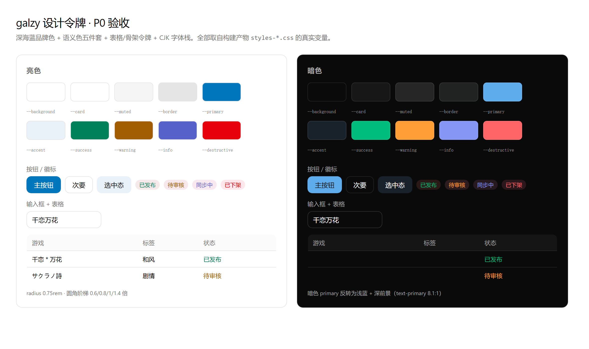

# galzy 前端 UI/UX 改造方案（仿照 new-api）

> 调研输入：`docs/ui-research/01-layout-nav.md`、`02-data-forms.md`、`03-visual-signature.md`、`04-galzy-audit.md`（共 1341 行，全部带源码行号）。
> 本方案是对这四份调研的**决策与排期**，不重复其证据链。

---

## 0. 一句话结论

new-api 值得抄的**不是蓝白配色**，而是两样东西：

1. **一套能用纯 CSS 表达的令牌系统**——语义色 + `color-mix` 从主色派生整层 surface + 四轴外观（色板/字体/圆角/密度）靠 `<body data-theme-*>` 落地，零运行时开销。
2. **三层组件纪律**——原子层（`ui/`）/ 业务基础层（`data-table/`、`drawer-layout`）/ feature 层，且『跨 ≥2 feature 才可下沉』。

galzy 与 new-api **同栈同源**（React 19 + TanStack Router + shadcn `base-nova` + Tailwind v4 + Base UI + OKLCH 变量 + sonner + motion），因此移植的是**设计语言**，不是代码。

三个必须先接受的前提：

| # | 前提 | 依据 |
| --- | --- | --- |
| 1 | **不能复制源码**，只能独立重实现 | new-api 是 AGPL-3.0，galzy 是 MIT（见 §1） |
| 2 | **控制台形态只用于后台**，用户端只借中性件 | new-api 是 AI 网关控制台（侧栏 + 高密度表格），galzy 是消费型内容站（海报栅格 + 沉浸详情页）；硬套侧栏会挤掉 `games/index.tsx:742` 的 6 列栅格 |
| 3 | **动效层不要动** | galzy 的原生 View Transition 共享元素、`dvh` 双写兜底、`pointer:coarse` 分级降级，成熟度高于 new-api（后者只有 motion 入场） |

---

## 1. 红线：许可证与复用边界

```
new-api  LICENSE 首行：GNU AFFERO GENERAL PUBLIC LICENSE Version 3
galzy    package.json:  "license": "MIT"
```

AGPL-3.0 是**传染性最强**的 copyleft：把 new-api 的前端源码（含 CSS 文件、组件文件）复制或改写进 galzy，会让 galzy 整体落入 AGPL 义务（必须开源、且网络服务也触发分发义务）。

| 做法 | 允许 | 说明 |
| --- | --- | --- |
| 复制/微调 new-api 的 `.tsx` / `.css` 文件 | ❌ | 包括 `theme.css`、`index.css`、`sidebar.tsx`、`data-table/**` |
| 保留其版权头、注释、命名 | ❌ | AGPL 文件头本身即归属声明 |
| 独立实现同等**视觉规格**（数值、尺寸、间距、层级） | ✅ | 尺寸与颜色值不构成表达性作品 |
| 沿用 shadcn 既有变量名（`--primary`、`--radius`…） | ✅ | 这是 shadcn/公共约定，非 new-api 独创 |
| 借鉴交互模式、布局结构、信息架构 | ✅ | 功能性设计 |

**执行纪律**：galzy 侧所有新增文件自己写、自己命名、自己注释；尺寸常量必须能说出『为什么是这个值』，而不是『new-api 是这么写的』。本方案下文给出的每个数值都已标注它在 galzy 体系里的角色。

---

## 2. 借鉴清单 / 不借鉴清单

### 2.1 值得借（按 ROI 降序）

| 借什么 | new-api 的做法 | galzy 的收益 | 成本 |
| --- | --- | --- | --- |
| **语义 surface 桥** | 非默认预设下 `--card/--popover/--muted/--border` 全用 `color-mix(in oklch, var(--primary) N%, var(--background))` 派生 | 换一个 `--primary` 整站换气质，不必逐令牌维护明暗两套 | 极低 |
| **语义色四件套** | `--success/--warning/--info/--neutral` 各带 `-foreground` | 直接消灭 galzy `104 处 / 31 文件` 硬编码调色板 | 低 |
| **`--table-*` 令牌组** | 6 个变量，亮色表头只叠 `foreground 1.5%`，暗色 6% | 6 个后台页的统一表格底色，不再每页手写 `bg-muted/50` | 低 |
| **`--skeleton-*` + shimmer** | 双变量驱动的 1.8s 渐变扫光，`reduced-motion` 降级为纯色 | 替换 `animate-pulse` 的『糊感』 | 低 |
| **`empty / error / loading` 三原子** | 一个 `Empty` 原子 + 表格内 `h-[400px]` / 页面 `min-h-[300px]` 两级；`ErrorState` 唯一红图标 + outline Retry | 收敛 galzy `24 文件 / 27 处` 手写空态 | 低 |
| **`ui/table` 薄壳** | 148 行纯样式，行高 `h-15`=60px、单元格 `whitespace-nowrap` + 强继承 | 6 个手写表格（4604 行）的统一视觉基线 | 低 |
| **`ui/pagination`** | 一套组件两形态（默认 / compact），候选 pageSize `[10,20,30,40,50,100]` | 收敛 galzy 9 处、2 套实现、`paginationRange` 复制 2 份 | 低 |
| **抽屉骨架为 className 工厂** | `drawer-layout.ts` 导出 5 个 className，可套 Sheet/Drawer/自定义容器 | galzy 已有 `sheet.tsx/drawer.tsx`，直接获得统一头/滚动区/粘底 footer | 低 |
| **`StatusBadge` 单一语义映射** | 一张 `variant → class` 表 + 3 种形态 + context 统一降级 | 消灭 `tasks-page.tsx` 单页 15 处硬编码色 | 低 |
| **`data-theme-scale` 密度轴** | 直接改写 `--text-*` 与 `--spacing`，组件零改动 | 内容站也能给『紧凑浏览 / 舒适阅读』 | 中 |
| **`SectionPageLayout` 页面插槽** | Title / Actions / Content / Footer 四插槽 + 页脚 `border-t` | galzy 的 7 处手写面包屑+页头有归属 | 中 |
| **NAV 模型 + ⌘K 同源** | 侧栏与命令面板吃同一份 `navGroups`，被权限过滤的页面不会出现在搜索里 | galzy 目前 `nav-config.ts` 与 `admin-nav.ts` 两套，容易长歪 | 中 |
| **入场尺度** | `opacity 0→1 + y 8→0 + blur(4px)→0.01px`，`transitionEnd` 释放 `filter` 规避 Android 白屏 | 与 galzy 现有 View Transition 同调，可共存 | 低 |

### 2.2 明确不借

| 不借 | 原因 |
| --- | --- |
| 用户端常驻侧栏 + 高密度表格 | galzy 用户端是内容发现流；侧栏会占掉 208px 并压缩海报栅格 |
| VChart / `@visactor` | galzy 已用 recharts；且 new-api 的 `--chart-1..5` 与真实图表配色**脱钩**（用 VChart 内置 dataScheme），是个坑不是优点 |
| `react-hook-form` + `ui/form.tsx` | galzy 用 `@tanstack/react-form`，只搬视觉契约（间距/红星/错误态），不搬库 |
| i18n 切换器 | galzy 目前纯中文，无 i18n 基础设施；等真要做国际化再说 |
| `next-themes` | 两仓都声明但都没用（new-api `src` 内 0 引用）。galzy 现有 `__root.tsx` 的 `THEME_INIT_SCRIPT` 更完整（还写 `style.colorScheme`） |
| 其死代码/缺陷 | `ui/breadcrumb` 144 行 0 使用；`SkipToMain` 指向不存在的 `#content`；`--max-content-width` 从未定义；侧栏折叠态用 `-mt-8 + opacity-0` 占位。**不要把这些一起搬过来** |
| `--radius: 1rem` 的默认值 | 1rem 是 1.6 倍于 galzy 现值，整站从『锐』变『圆』；见 §4.1 决策 D2 |

---

## 3. 现状基线（浓缩）

以下数字是改造的**验收起点**，来自实际扫码：

| 指标 | 现状 | 目标 |
| --- | --- | --- |
| `--primary` chroma | 0（纯灰，`styles.css:35`） | 有品牌色相 |
| 语义色令牌 | 仅 `destructive` | success/warning/info/neutral + 各 foreground |
| 硬编码调色板 | **104 处 / 31 文件** | 0 |
| `components/ui` 组件数 | 35 | 初见 48（+13 个关键件） |
| 手写 `<table>` 后台页 | 6 页 / **4604 行** | 0 |
| 分页实现 | 9 处 / 2 套 | 1 处 / 1 套 |
| 后台筛选是否入 URL | 否（`useState`） | 是（`validateSearch`） |
| `--radius` | 0.625rem | 0.75rem（或 1rem，见 D2） |
| CJK 字体栈 | 无（中文落泛型 `sans-serif`） | 显式 5 级回退链 |
| `@source not` 排除且无 import 的死文件 | 11 个 | 删除或启用 |

**做得比 new-api 好、不要动**：`styles.css:153-165` dvh 双写兜底、`:199-340` View Transition 共享元素与 `pointer:coarse` 分级、`mobile-menu.tsx:130-165` 自管焦点归还、`shared/route-skeletons.tsx` 每页专用骨架、`admin-nav.ts` 单一配置源（比 new-api 的三层过滤更干净）。

---

## 4. 目标设计体系

### 4.1 令牌层（P0，一个文件搞定大半）

改 `apps/web-tanstack/src/styles.css`。三块改动：

**① 补语义色 + 扩展令牌**（在现有 `:root` / `.dark` 内追加）

~~~css
/* 语义色：与 destructive 同构，各带 foreground */
--success: oklch(0.596 0.145 163.225);
--success-foreground: oklch(0.985 0 0);
--warning: oklch(0.681 0.162 75.834);
--warning-foreground: oklch(0.145 0 0);
--info:    oklch(0.588 0.158 241.966);
--info-foreground: oklch(0.985 0 0);
--neutral: oklch(0.708 0 0);
--neutral-foreground: oklch(0.145 0 0);
--destructive-foreground: oklch(0.985 0 0);

/* 表格：亮色只叠 1.5%，暗色 6% —— 只做同色系微提亮，不引第二色相。
   用 oklab 而非 oklch，理由见 §4.2 的警告。 */
--table-header: color-mix(in oklab, var(--foreground) 1.5%, var(--background));
--table-header-hover: color-mix(in oklab, var(--foreground) 3%, var(--background));
--table-disabled: color-mix(in oklab, var(--foreground) 3%, var(--background));
--table-disabled-border: color-mix(in oklab, var(--foreground) 16%, var(--background));

/* 骨架屏 */
--skeleton-base: oklch(0.97 0 0);
--skeleton-highlight: oklch(0.985 0 0);

/* 顶栏高度：消灭 pt-14 / scroll-padding-top: 4.5rem 两个不同步的魔法数 */
--app-header-height: 3.5rem;
~~~

暗色块对应值：`success oklch(0.696 0.17 162.48)`、`warning oklch(0.769 0.188 70.08)`、`info oklch(0.613 0.14 239.919)`、`neutral oklch(0.76 0 0)`；`table-*` 比例提到 6% / 9% / 7% / 24%；`skeleton-base 0.335` / `highlight 0.44`。

**② 补 `@theme inline` 映射**（现有映射缺一半，导致 `bg-success` 这类类名根本不存在）

~~~css
--color-success: var(--success);
--color-success-foreground: var(--success-foreground);
--color-warning: var(--warning);
--color-warning-foreground: var(--warning-foreground);
--color-info: var(--info);
--color-info-foreground: var(--info-foreground);
--color-neutral: var(--neutral);
--color-neutral-foreground: var(--neutral-foreground);
--color-destructive-foreground: var(--destructive-foreground);
--color-table-header: var(--table-header);
--color-skeleton-base: var(--skeleton-base);
~~~

**③ CJK 字体栈**（这是 galzy 当前最容易被忽略的观感缺陷：中文落泛型 `sans-serif`，Windows / Android / macOS 各不相同，行高与字重漂移）

~~~css
--font-sans: 'Geist Variable', 'PingFang SC', 'Hiragino Sans GB',
  'Microsoft YaHei', 'Source Han Sans SC', 'Noto Sans SC', 'WenQuanYi Micro Hei',
  sans-serif;
~~~

注意顺序：Geist 只覆盖拉丁，中文由后四级逐级兜底。**不要**把 `'Noto Sans SC'` 放前面（多数系统没装）。若要求跨平台完全一致，才考虑自托管 `@fontsource-variable/noto-sans-sc`（体积代价 2MB+，建议延后到 P5）。

**品牌主色（D1 已定 = 深海天蓝）**

| 位置 | 值 | 渲染 | 对比度 |
| --- | --- | --- | --- |
| light `--primary` | `oklch(0.55 0.14 245)` | `#0077BD` | 白字 **4.67:1** ✅ AA |
| dark `--primary` | `oklch(0.72 0.12 245)` | `#5EACEB` | 深前景 **7.30:1** ✅ |
| dark `text-primary` on 画布 | 同上 | `#5EACEB` / `#0A0A0A` | **8.07:1** ✅ |

暗色沿用 galzy 原有的「浅底 + 深前景」反转约定（改造前 `--primary` 是近白 `0.922`），所以
`text-primary` 在深底上依然醒目，不必引入第二套语义。

> **new-api 的缺陷（已实测，未照抄）**：它的亮色 `--primary = oklch(0.692 0.141 243.716)`
> 配白字实测只有 **2.72:1** —— 连大字号的 3:1 都不到。galzy 把 L 压到 0.55 后是 4.67:1。
> 彩度上限 0.14 也不是随意取的：hue 245 在 L 0.55 处的 sRGB 边界正是 0.14，再高会溢出
> P3 色域，浏览器裁切后色相会偏。

### 4.2 语义 surface 桥（P0 最后一刀，可选但强烈建议）

思路：**中性面保持 chroma=0（可被乘色的基底）**，需要换肤时用极低比例的主色混入整层 surface。

~~~css
/* 只在显式选定非默认色板时生效；默认保持纯灰 */
[data-theme-preset]:not([data-theme-preset='default']) {
  --card:    color-mix(in oklab, var(--primary) 3%,  var(--background));
  --popover: color-mix(in oklab, var(--primary) 5%,  var(--background));
  --muted:   color-mix(in oklab, var(--primary) 7%,  var(--background));
  --accent:  color-mix(in oklab, var(--primary) 14%, var(--background));
  --border:  color-mix(in oklab, var(--primary) 20%, var(--background));
}
~~~

效果：选中某个色板后，卡片、边框、muted、popover 全部极淡地跟着变色，但仍是『灰面稍染色』而不是『粉色主题』。10 套色板总共只需要 12 个变量/套。

> ### ⚠ 本方案唯一一处「照抄会翻车」的地方：必须 `oklab`，不能 `oklch`
>
> **现象**（P0 实施时实测发现）：品牌蓝 `oklch(0.55 0.14 245)` 混白 10%，
> 期望得到淡蓝 `#E9F1F9`，浏览器实际渲染出**粉色 `#F8EDF2`**。
>
> **原因**：`color-mix(in oklch, …)` 在**极坐标**空间插值，色相参与计算。
> 白色的色相是 0°，品牌蓝是 245°，两者取短弧是 `245° → 360°`（+115°）；
> 10% 混入后色相被拉到 `245 + 0.9×115 = 348.5°`，正好落进粉色区。
>
> **验证**：把各插值假设都算出来比对，只有 348.5° 命中实测值：
>
> | 插值假设 | 结果 | 与实测 |
> | --- | --- | --- |
> | 白色色相"无力"、继承 245° | `#E9F1F9` | ❌ |
> | 色相按长弧 245→0 插值（24.5°） | `#FAEDEB` | ❌ |
> | **色相按短弧 245→360 插值（348.5°）** | **`#F8EDF2`** | **✅ 一致** |
> | sRGB 直接混合 | `#E6F1F8` | ❌ |
> | oklab 直角空间混合 | `#E9F1F9` | ❌（但这正是我们要的结果） |
>
> **结论**：`oklab` 不含色相分量，混色只改明度与彩度、色相恒定 —— 这才是「染色」的语义。
> 全站 24 处派生令牌（`--accent`、`--sidebar-accent`、`--table-*`、色板 surface 桥）
> 统一用 `in oklab`。这条已写进 `styles.css` 注释，防止后人改回 `oklch`。

### 4.3 外观轴（P5，可选）

只剩三轴值得做（色板 / 圆角 / 密度），字体轴跳过：

~~~css
[data-theme-radius='sm'] { --radius: 0.5rem; }
[data-theme-radius='md'] { --radius: 0.75rem; }
[data-theme-radius='lg'] { --radius: 1rem; }

[data-theme-scale='sm'] {--text-xs:0.7rem;--text-sm:0.78rem;--text-base:0.88rem;--spacing:0.225rem;}
[data-theme-scale='lg'] {--text-xs:0.84rem;--text-sm:0.95rem;--text-base:1.075rem;--spacing:0.28rem;}
~~~

落地方式：React `useEffect` 把偏好写成 `<body data-theme-*>`，CSS 靠**书写顺序**层叠（预设在前、轴在后），不做 JS 算色。galzy 已有 `themeStore` 雏形可复用。

### 4.4 动效对齐（不重写，只补三处）

| 补什么 | 值 | 理由 |
| --- | --- | --- |
| 统一缓动令牌 | `--ease-out-quart: cubic-bezier(0.22, 1, 0.36, 1)`（已存在） | 已是 galzy 现用值，与 View Transition 一致 |
| 卡片 hover | `translateY(-1px)` + `shadow 0 4px 12px rgb(0 0 0 / .06)`，150ms；暗色 `.3` 透明度 | 静止态靠 `ring-1 ring-foreground/10` 定界、无阴影，hover 才浮起 |
| 表格逐行入场 | `opacity 0→1 + y 4→0`，`nth-child` 每行 +25ms，最多到第 11 行 | 列表页『数据到位』的反馈，成本极低 |
| 数字等宽 | `[data-slot='table'] td { font-variant-numeric: tabular-nums }` | 后台金额/额度/ID 列对齐 |

以上全部要包在 `@media (prefers-reduced-motion: no-preference)` 内，并保留 galzy 现有的 `reduce` 分支。

---

## 5. 分阶段实施

每个阶段独立可合并、可回滚。**不要跳阶段**：P0 不做就动布局，104 处硬编码色会跟着搬迁，成本翻倍。

### P0 · 令牌（约 0.5 天，1 个文件）

- 文件：`apps/web-tanstack/src/styles.css`（+ `__root.tsx` 的 `THEME_INIT_SCRIPT` 若要改主色）
- 内容：§4.1 三块 + 品牌主色（D1）
- **`--radius` 改动单独一次 commit**（整站观感变化，便于单独回滚）
- 验收：
  - `bun --cwd apps/web-tanstack build` 通过
  - 手动核对明暗两态下 `Button/Card/Input/Badge` 四件的对比度
  - 截图留档（首页 / 列表 / 详情 / 后台各一张，明暗各一份）作为后续回归基线

### P1 · 原子组件（约 2–3 天，新增 13 个文件）

新增（全部自己实现，参考视觉规格）：

~~~
components/ui/table.tsx          行高 h-15、表头 h-10、单元格 whitespace-nowrap + 强继承
components/ui/pagination.tsx     默认 + compact 两形态，候选 [10,20,30,40,50,100]
components/ui/empty.tsx          Empty + Header/Media/Title/Description/Content 六件
components/ui/kbd.tsx
components/ui/switch.tsx         （现有 @source not 的 animate-ui 版本不启用）
components/ui/checkbox.tsx
components/ui/command.tsx        需新增依赖 cmdk（D3）
components/status-badge.tsx      variant → class 单一映射表 + 3 形态
components/drawer-layout.ts      5 个 className 工厂，不导出组件
components/page-frame.tsx        等价 SectionPageLayout：Title/Actions/Content/Footer 四插槽
components/empty-state.tsx       页面级 min-h-[300px]
components/error-state.tsx       唯一红图标 + outline Retry
components/loading-state.tsx
~~~

- 同时删掉 11 个 `@source not` 死文件（`ui/sonner.tsx`、`ui/accordion.tsx`、`ui/calendar.tsx` 等），并为 `ui/calendar.tsx` 决定：启用还是删除（后台日期筛选目前退回原生 `input[type=date]`）
- 验收：新增组件各写一个 Vitest 用例（项目已有测试基建），覆盖禁用态/空态/键盘可操作

### P2 · 后台表格迁移（5–7 天，ROI 最高）

**为什么要先做后台**：后台已是独立壳（`__root.tsx:177-179` + `_authL.tsx:24-30`），改坏不影响线上站点，且 6 页 4604 行重复代码是最大技术债。

数据层组件（约 10 个文件，是 new-api 26 文件系统的精简版）：

~~~
components/data-table/data-table-page.tsx      工具条 → 表格/移动卡片 → 分页/空态/骨架 的总装
components/data-table/data-table-view.tsx
components/data-table/column-header.tsx        排序菜单（Asc/Desc/Hide）
components/data-table/toolbar.tsx              搜索 + 筛选 chip + 视图切换
components/data-table/table-empty.tsx          h-[400px]
components/data-table/table-skeleton.tsx       min(pageSize,20) 行 / 52px
components/data-table/mobile-card-list.tsx     ≤640px 自动降级（galzy 现在只能横滚）
components/data-table/pagination.tsx
hooks/use-table-url-state.ts                   筛选/page/pageSize 双向绑定 URL
hooks/use-data-table.ts                        TanStack Table 封装
~~~

新增依赖：`@tanstack/react-table`（galzy 目前只有 `react-virtual`，没有 table）。

**迁移顺序**（由简到繁，每步一个 PR）：

| 步 | 页面 | 行数 | 风险 |
| --- | --- | --- | --- |
| 1 | `topics-page.tsx` | 485 | 最低，先验证骨架 |
| 2 | `articles-page.tsx` | 634 | 低 |
| 3 | `comments-page.tsx` | 698 | 中（嵌套结构） |
| 4 | `users-page.tsx` | 860 | 中（5 个 Dialog → 1 抽屉 + 1 确认） |
| 5 | `collections-page.tsx` | 1004 | 中（已有行选择） |
| 6 | `tasks-page.tsx` | 923 | 中（15 处硬编码色收口） |

每步同时做三件附带修复：

1. `useState` 筛选 → `validateSearch`（修掉『刷新/返回丢筛选』）
2. 写死 `PAGE_SIZE` → 全局 localStorage 键 + URL `page/pageSize`（修掉 9 处分页 2 套实现）
3. 每个动作一个 Dialog → 一个 `UsersMutateDrawer`（抽屉）+ `ConfirmDialog`（破坏性），参照 §4 的宽度谱系：普通实体 `600px`、多分组配置 `2xl`

验收：6 个页面净删代码 ≥ 3000 行；`rg '<table' apps/web-tanstack/src/components/admin` 返回 0；375px 视口下列表可用（卡片降级）。

### P3 · 后台外壳（2–3 天）

现状问题：`admin-shell.tsx:203` 顶栏 `sticky h-14` + `aside fixed w-64`（`:243`）+ `lg:pl-64`（`:252`）——高度 14 与左内边距 64 是两处必须人肉同步的魔法数。

改造：

~~~
admin-shell.tsx
  ├─ 顶栏 h-(--app-header-height)          ← 消除 h-14 / pt-14 / scroll-padding-top 三处不一致
  ├─ 内容 h-[calc(100svh-var(--app-header-height))]  ← 声明式，不再手算
  ├─ aside → 可折叠（icon 模式 44px）+ cookie 记忆 + ⌘B
  └─ admin-nav.ts 升级：
       NavItem 增加 activeUrls / requiredRole / badge（保留现有单一配置源的优势）
       增加 SidebarView 注册表：进入 /admin/vndb-sync、/admin/meilisearch、/admin/tasks
       时整个侧栏切换为子导航 + 『← 返回仪表盘』（drill-in，41 行即可）
~~~

同时把 ⌘K 面板接上同一份 nav 数据（`cmdk`，见 D3）——被权限过滤的项不会出现在搜索里。

### P4 · 用户端（3–5 天）

用户端只做『骨架能力』+ 三处具体病症，**不引入侧栏**。

| 项 | 现状 | 改法 |
| --- | --- | --- |
| 顶栏收缩抖动 | `Header.tsx:101` 滚动后 `max-w-7xl → max-w-4xl`（78%），宽屏下顶栏与内容左右边界错位 | 取消容器宽度收缩，改为『高度收缩 + 背景变玻璃』；容器宽度全站统一 |
| 两套栅格 | 用户端 `max-w-7xl` vs 后台 `max-w-6xl` | 统一到一个 `page-frame` 容器宽度令牌 |
| 首页首屏无锚点 | `home-hero.tsx:13` 只有一行 `text-4xl` 纯文字 + 一个 outline Badge，无数据背书 | 加『收录 N 部 / N 个标签 / N 位制作组』的实时计数条（数据已存在 —— `CountComponent` 现在排在 hero 之后），配一张视觉锚点（渐变网格 / 封面拼贴） |
| 列表页信息缺失 | `games/index.tsx` 无结果计数、无已选 chip、无重置；栅格只有 `3 → 6` 两档（缺 `sm`）；日期筛选只在首页搜索框里 | 补 `sm:4` 档；加结果计数 + 已选条件 chip + 重置；把 `startDate/endDate` 提到列表页筛选条（启用 `ui/calendar`） |
| 面包屑手写 7 处 | 无路由派生 | 用 `useMatches` 统一派生（放 `page-frame.tsx`） |
| 广告位错位 | `__root.tsx:190-227` `id='sidebar-ad'` 却在正文上方，`lg:px-24` 让图比正文窄且不居中 | 改名 `banner-slot`，与正文同容器宽度 |
| 详情页 | 单列到底 `Card border-0` 与同页第二张 Card 边框不一致 | ≥lg 加右侧信息栏（制作组/发售日/标签），统一 Card 边框策略 |

### P5 · 外观轴与收尾（可选，2 天）

- 3–5 套 galgame 主题色板（`data-theme-preset`）+ 圆角/密度轴
- 自托管中文可变字体（若跨平台一致性成为需求）
- 长文排版：攻略/简介页接 `@tailwindcss/typography`（已装）统一 `prose` 尺度

---

## 6. 硬编码色收敛（贯穿 P0–P2）

**先量化，再收敛，全程可回归**：

~~~bash
# 基线（改造前跑一次，记下数字）
rg -c 'text-(green|red|blue|amber|yellow|emerald|sky|rose|orange)-[0-9]{3}' \
   apps/web-tanstack/src --glob '!**/ui/**' | wc -l
~~~

映射表（机械替换，逐文件 review）：

| 现写法 | 改为 |
| --- | --- |
| `text-green-600 border-green-600/30` | `text-success border-success/30` |
| `text-red-600 / bg-red-500` | `text-destructive / bg-destructive` |
| `text-amber-600 / text-yellow-600` | `text-warning` |
| `text-blue-500 / text-sky-600` | `text-info` |
| `bg-muted/50`（表格头） | `bg-[color:var(--table-header)]` 或 `ui/table` 默认 |
| `hover:bg-muted/30`（表格行） | 由 `ui/table` 内置 `color-mix` hover 接管 |
| `animate-pulse`（骨架） | `.skeleton-shimmer` |

最脏的两处：`users-page.tsx:263`、`tasks-page.tsx:100-141`（单页 15 处）。

---

## 7. 四个决策（已定）

| 编号 | 决策 | 结论 | 落地情况 |
| --- | --- | --- | --- |
| **D1** | 品牌主色 | **B 深海天蓝** `oklch(0.55 0.14 245)` / 暗色 `oklch(0.72 0.12 245)` | ✅ P0 已落地，24 对对比度全部 AA |
| **D2** | 圆角基准 | **0.75rem 起步**，1rem 做成 `[data-theme-radius='lg']` 让用户自选 | ✅ P0 已落地（三档 sm/md/lg） |
| **D3** | 依赖 | `cmdk` + `@tanstack/react-table` 都装 | ⏳ P1 首步安装（P0 无代码消费，故未提前装） |
| **D4** | 推进顺序 | 按 P0→P5 顺序；后台用不到的原子件挪到 P3 | ✅ 已按此排期 |

---

## 8. 风险与对策

| 风险 | 影响 | 对策 |
| --- | --- | --- |
| AGPL 污染 | 法务级 | §1 纪律；review 时对新增文件的注释/命名做一次专门检查 |
| `--radius` + 主色同时改，视觉突变不可归因 | 回滚困难 | 分两次 commit，各留明暗截图 |
| 后台迁移期间新旧表格并存 | 观感割裂 | 按 §5 顺序一页一 PR，每页迁移完即删旧代码 |
| 抽屉替换 Dialog 后移动端键盘遮挡 | 可用性回退 | 抽屉高度用 `h-dvh` + 表单区唯一滚动 + footer 粘底（§4 骨架），并在真机验证 |
| TanStack Table 引入后 SSR 水合差异 | 报错 | 列定义 → `useMemo`；首屏用 `static-data-table` 形态 |
| 中文系统字体栈在不同平台行高漂移 | 观感不稳 | 先上 5 级回退链；若仍漂移，P5 自托管 Noto Sans SC |

---

## 9. 调研文档索引

| 文件 | 行数 | 内容 |
| --- | --- | --- |
| `docs/ui-research/01-layout-nav.md` | 414 | 外壳 DOM、尺寸真值表、NAV 数据模型、`$section` + drill-in、主题/token 注入、⌘K、8 条不一致清单 |
| `docs/ui-research/02-data-forms.md` | 306 | 表格三层与行高、`--table-*` 六变量、分页/密度/列显隐、表单视觉契约、弹窗抽屉选型谱系、反馈三态、徽标语义 |
| `docs/ui-research/03-visual-signature.md` | 320 | 令牌全表（明暗）、色彩策略、四轴预设机制与层叠顺序、卡片语言、图表、动效、字体 |
| `docs/ui-research/04-galzy-audit.md` | 301 | galzy 现状：双壳栅格、令牌缺口、组件 35 vs 60、6 页 4604 行手写表格、9 处分页、表单与弹窗问题、响应式 |

---

## 10. P0 落地记录（已完成）

**改动范围：1 个文件 + 1 个新脚本。** `apps/web-tanstack/src/styles.css` 422 → 609 行。

### 10.1 实际写入的令牌

| 类别 | 令牌 |
| --- | --- |
| 品牌 | `--primary` / `--primary-foreground` / `--ring`(=`var(--primary)`) |
| 语义 | `--success` `--warning` `--info` `--neutral` `--destructive` 各带 `-foreground` |
| 派生 | `--accent` `--sidebar-accent` `--sidebar-primary` `--sidebar-ring` |
| 表格 | `--table-header` `-hover` `--table-disabled` `-hover` `-border` |
| 骨架 | `--skeleton-base` `--skeleton-highlight` + `.skeleton-shimmer` |
| 布局 | `--app-header-height: 3.5rem`，`scroll-padding-top` 改为由它派生 |
| 轴 | `[data-theme-radius]` 三档、`[data-theme-preset]` surface 桥（含暗色） |
| 桥 | `@theme inline` 补 9 条颜色映射（否则 `bg-success` 这类类名根本不会生成） |
| 字体 | `--font-sans` 追加 6 级 CJK 回退链 |

### 10.2 与初版方案的四处偏差（都是实施时发现的）

| # | 初版方案 | 实际落地 | 原因 |
| --- | --- | --- | --- |
| 1 | 语义色沿用 Tailwind 500 档明度 | 亮色压到 L 0.53–0.57 | 500 档当 `text-success` 只有 2.9–3.7:1，不达标（见 §10.3） |
| 2 | `--info` 取蓝 242° | 改**靛蓝 275°** | 品牌色已是天蓝 245°，info 会和主按钮撞色分不出 |
| 3 | `--warning` 保持 75.8° 色相 | 改**62°** | 压到 AA 明度后 75.8° 会偏橄榄绿，62° 仍是暗金橙 |
| 4 | 派生一律 `color-mix(in oklch)` | 全部改 **`in oklab`** | oklch 会旋转色相，10% 蓝混白变粉（见 §4.2 警告框） |

### 10.3 对比度验收（可复跑）

新增 `apps/web-tanstack/scripts/check-contrast.ts`，直接解析 `styles.css` 的真实令牌值计算
WCAG 对比度，不达标即非零退出：

~~~bash
cd apps/web-tanstack && bun run check:contrast
~~~

当前 **24 对全部通过**：亮色最低 4.67:1（按钮白字 / primary），暗色最低 5.06:1。

同时验证了 new-api 的原始缺陷：它的亮色 `--primary` 配白字**只有 2.72:1**。

### 10.4 视觉验收



图为用**构建产物里的真实 CSS**（非手写副本）渲染的明暗双态色板 + 按钮/徽标/输入框/表格。
渲染方式：headless Chrome 加载 `file://` 页面，像素采样核对。

### 10.5 三道关

| 检查 | 结果 |
| --- | --- |
| `bunx --bun vite build` | ✅ 通过（2.9s） |
| `bun run lint`（oxlint，300 文件） | ✅ 0 warning / 0 error |
| `bun run check:contrast` | ✅ 24/24 |

### 10.6 已知未处理（有意留到后续阶段）

| 项 | 说明 | 计划 |
| --- | --- | --- |
| `--border` / `--input` 对画布仅 1.26:1 | WCAG 1.4.11 对「装饰性分隔线」豁免；输入框靠 `--ring`(品牌蓝) 承担焦点可见性。若提到 3:1 需把 `--input` 压到 L≈0.67，整站边框会明显变重 | 需要你确认是否要这个视觉代价 |
| lightningcss 为 `color-mix` 生成 `@supports` 降级 | 不支持 color-mix 的浏览器会退回 `var(--primary)`（如 preset 卡片变实色）。但这类浏览器同样不支持 oklch，调色板整体已失效，故无实际影响 | 不处理 |
| `cmdk` / `@tanstack/react-table` | P0 无代码消费 | P1 首步安装 |
| 硬编码色 104 处 | 令牌已就位，替换按 §6 映射表在 P1–P2 逐文件做 | P1–P2 |

